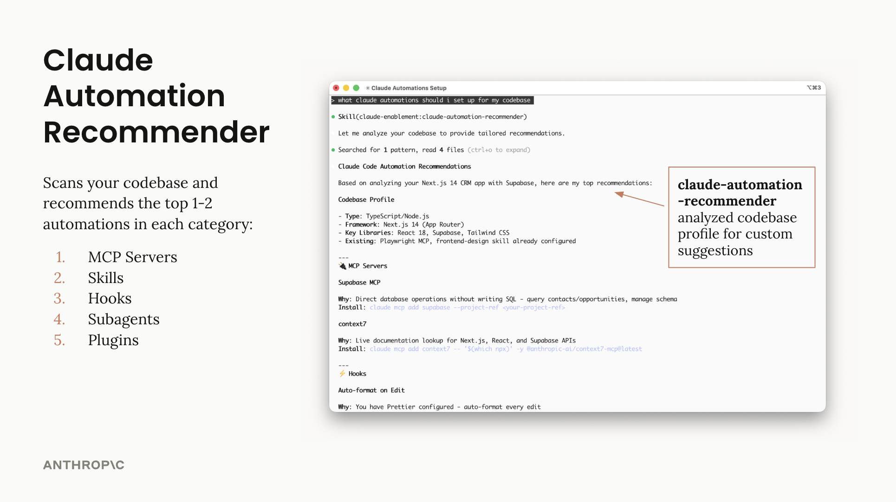

# Claude Code Setup 插件

分析代码库并推荐量身定制的 Claude Code 自动化方案——钩子、技能、MCP 服务器等。

## 功能

Claude 使用此技能扫描你的代码库，并针对每个类别推荐最值得采用的 1-2 项自动化方案：

- **MCP 服务器** - 外部集成（用于文档查询的 context7、用于前端的 Playwright）
- **技能** - 打包好的专业知识（Plan agent、frontend-design）
- **钩子** - 自动执行的操作（自动格式化、自动 lint、阻止敏感文件）
- **子智能体** - 专项审查者（安全、性能、无障碍）
- **斜杠命令** - 快捷工作流（/test、/pr-review、/explain）

该技能是**只读**的——只做分析，不会修改文件。

## 用法

```
"为这个项目推荐自动化方案"
"帮我配置 Claude Code"
"我应该使用哪些钩子？"
```



## 作者

Isabella He (isabella@anthropic.com)
