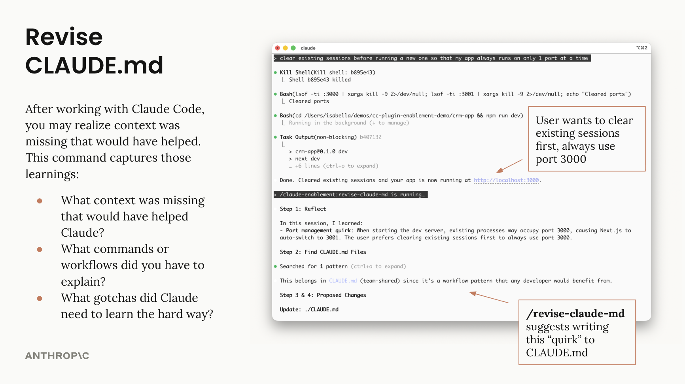

# CLAUDE.md 管理插件

用于维护和改进 CLAUDE.md 文件的工具——审计文件质量、沉淀会话经验，让项目记忆保持最新。

## 功能

两个互补的工具，各有不同用途：

| | claude-md-improver（技能） | /revise-claude-md（命令） |
|---|---|---|
| **用途** | 让 CLAUDE.md 与代码库保持一致 | 沉淀会话中的经验 |
| **触发时机** | 代码库发生变化 | 会话结束时 |
| **适用场景** | 定期维护 | 会话中发现了缺失的上下文 |

## 用法

### 技能：claude-md-improver

对照代码库的当前状态审计 CLAUDE.md 文件：

```
"审计我的 CLAUDE.md 文件"
"检查我的 CLAUDE.md 是否为最新"
```


### 命令：/revise-claude-md

记录当前会话中的经验：

```
/revise-claude-md
```



## 作者

Isabella He (isabella@anthropic.com)
