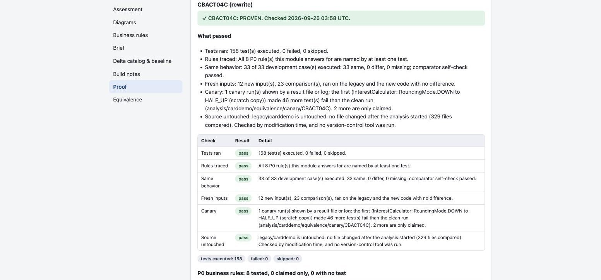
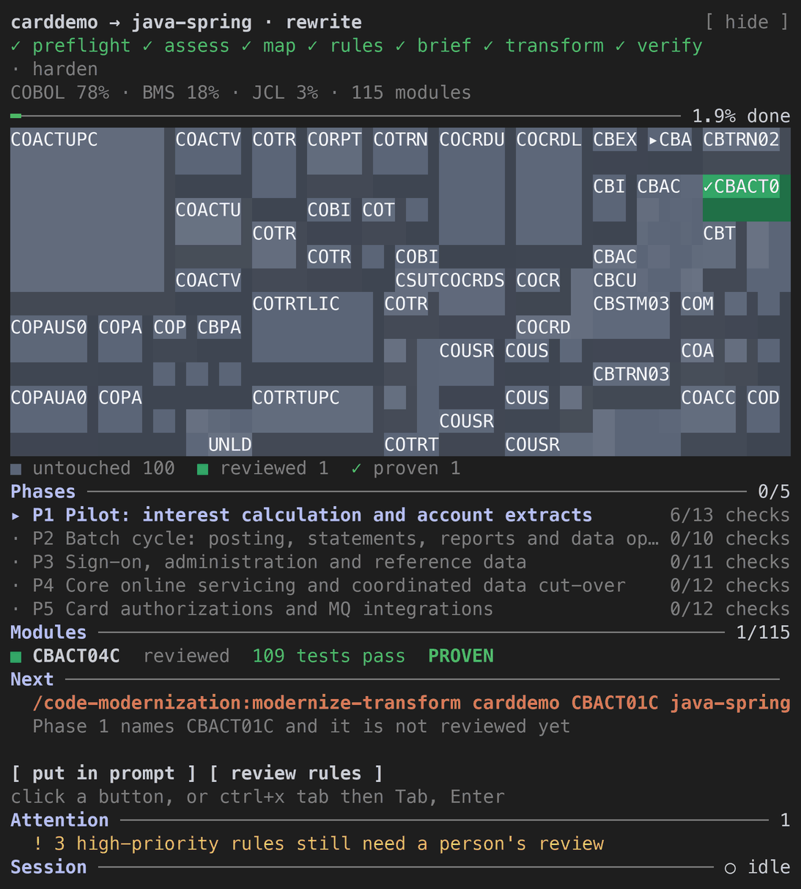

# 代码现代化

让 Claude 面向一个遗留代码库，你会得到四样东西：对"它是什么、做什么"的理解、一份由你批准的计划、现代化后的代码，以及**新代码行为与旧代码一致的证明**。它适用于任何语言和任何类型的迁移：同一技术升级到更新版本、用另一种技术重写，或在新架构上重建。


## 安装

你需要 [Claude Code](https://code.claude.com)。然后运行：

```
/plugin install code-modernization@claude-plugins-official
```

一些步骤会同时启动许多智能体，因此在大型系统上要有真实用量的心理准备（见*预期情况*）。先拿一个模块或一个单元做试点，不要一上来就是整个代码资产。

## 从这里开始

为这项工作打开一个文件夹，然后输入 `/code-modernization:modernize`。它会询问你想对代码做什么（几个简短的问题），找到代码，把你的回答一次性记录下来，展示前方的路线，并给出确切的第一条命令。后续每条命令都会读取你说过的话，所以任何问题都不会被问第二遍。**还不确定想做什么？** 选择 *Understand it first*（先理解它）：你会得到评估、结构图、业务规则和一份计划，且不会有任何代码被重建。

如果想一步一步来，可以先让第一条命令指向你的代码，然后跟随每条命令结尾的"下一步"提示行：

```
/code-modernization:modernize-preflight <name> --source <path to your code>
/code-modernization:modernize-status <name>       # 我在哪里、下一步是什么：随时可以运行
```

`<name>` 是你自定的简短标签（字母、数字、`-`、`_`）。`--source` 会在 `legacy/<name>` 处建立一个链接而不复制任何内容，因此庞大的仓库原地不动。**没有任何操作会修改你的遗留源码。** 命令只写入 `analysis/<name>/` 和 `modernized/`（构建检查会把构建产物写到你的构建通常输出的位置），并且每条命令都会刷新 `analysis/<name>/REPORT.html`：一页纸上汇总目前所有发现，可以打开也可以分享。少数几个步骤需要懂系统如何构建和运行的人，所以最开始的几个问题请找一位工程师来回答。

## 流程

每个步骤都相互独立，你可以在任何一步之后停下来审阅。

| 步骤 | 命令 | 你会得到 |
| --- | --- | --- |
| 0 | `modernize` | 说明你想要什么。写入 `INTENT.md`；后续每条命令都会读取它。 |
| 1 | `modernize-preflight <name> [target-stack] [--source <path>]` | 环境是否就绪？询问五个只有人才能回答的问题（这是完整系统还是一个切片、能否在这里构建和测试、有没有自定义构建工具、以前有没有人尝试过、有没有禁区），证明构建在这份代码上可行，并找出缺失的源码。 |
| 2 | `modernize-assess <name>` | 我面对的是什么：清单、复杂度、技术债、安全性，以及一个推荐的模式。 |
| 3 | `modernize-map <name>` | 系统结构：依赖关系、数据流、入口点和业务流程，以交互式图呈现。 |
| 4 | `modernize-extract-rules <name>` | 业务规则以可测试的 Given/When/Then 卡片呈现，附 `file:line` 引用，每条都由第二个智能体复核。 |
| 4b | `modernize-review <name>` | 由人来确认或纠正看起来有误的规则。你的回答会进入计划和构建。开启实时面板后，`/modernize-review-pane` 可以逐张卡片完成同样的事。 |
| 5 | `modernize-brief <name> [target-stack]` | 供指导委员会批准的分阶段计划。**在你批准之前不会构建任何东西。** |
| 6 | `uplift`、`transform` 或 `reimagine` | 构建（见下文）。 |
| 7 | `modernize-verify <name>` | **证明。** 一次独立复核，每个模块给出一个判定。 |
| 8 | `modernize-harden <name>` | 对遗留系统的安全扫描，附带经复核的补丁，由你自行应用。 |

`assess --portfolio <parent-dir>` 可以调研多个系统并在一页上排出优先级。`modernize-status <name>` 会告诉你目前的进度，并给出可直接粘贴的确切命令。

**有六个决策点由人来决定**，插件绝不替你决定：preflight 的五个回答、看起来有误的规则（`review`）、批准计划书、接受证明发现的任何差异、签署证明，以及应用安全补丁。

## 它如何证明结果

现代化的失败是无声的：新代码通过了别人写的测试，却在没人想到的输入上表现不同。因此证明建立在脚本能检验的证据之上，而不是模型的自我判断。`modernize-verify` 在构建之后运行（最好在一个全新会话中），它会重做各项工作，而不是信任构建留下的记录：

- **测试，从干净状态重新运行。** 构建产物被删除，完整测试套件重新运行，计数来自测试运行器自己的结果文件或保存的日志。一次没有执行任何测试、或跳过了测试的运行即为失败，命令仅仅"打出来"的计数不作数。
- **新旧代码在相同输入上运行。** 在遗留代码可以运行的地方，两者在相同输入上运行，由脚本逐字节比较。只有必然变化的字段（时间戳、生成的 id）会被屏蔽，浮点输出可以在声明的容差内比较，且每个被屏蔽的字段都列在结果中。被人接受的差异会连同原因记录在案。
- **没人用过的输入。** 它会构造至少十个新输入（边界值、空值、超大值、异常顺序，以及——当你要求精确复刻行为（含怪癖）时——格式错误的记录），然后再次比较，从而抓住那些只在模型自己选的用例上通过的测试套件。
- **测试必须能够失败。** 一次故意的单行破坏必须让测试变红（金丝雀），比较机制本身也通过改动输出的一个字节来检验。
- **每条关键规则都有实际运行过的测试支撑。** 每条 P0 业务规则必须由一个真正执行并通过的测试来指名。只被跳过或待定测试指名的规则会列为"仅指名未运行"，而自身不含任何代码的测试文件夹会被列为工具目录，不参与判定。
- **源码未被改动**，通过文件时间戳检查，而不在分析目录内运行任何东西。

每个模块得到一个判定，由 `scripts/proof_pack.py` 根据这些文件计算，判定规则直接写进输出：**PROVEN**（已证明）、**PARTLY PROVEN**（部分证明，附缺失项）或 **NOT PROVEN**（未证明：什么都没运行、存在差异、或有测试失败）。如果旧系统无法在你的工作环境运行（大型机程序、只在生产环境运行的系统），旧有行为只能对照录制输出检查，此时最好的判定是 PARTLY PROVEN：页面会明确说明。任何需要人来决定的事项（未决问题、退出标准、签署确认）都会列为等待人来处理，绝不会替你打钩。每个判定每次都根据当前证据重新计算；不会沿用早前运行的结果。



## 选择构建方式（计划会推荐一种）

| 如果你想要 | 运行 | 会发生什么 |
| --- | --- | --- |
| 同一技术升级到更新版本（.NET Framework 到 .NET 8、Java 8 到 17、Spring Boot 2 到 3） | `modernize-uplift <name> [source-version] [target-version]` | 保留你的代码，只修复新版本破坏的部分，由这份代码实际会遇到的破坏性变更目录驱动。先做一个试点单元并记录经验，再分批推进。证明是在两个版本上运行同一测试套件。 |
| 换用新技术，一次一个模块，同时旧系统继续运行 | `modernize-transform <name> [module] [target-stack]` | 一份由你批准的计划、固定旧有行为的测试、符合目标语言习惯的重写，以及证明：新旧代码在相同输入上运行，由脚本比较结果。 |
| 在新架构上重建 | `modernize-reimagine <name> [target-vision]` | 从代码中提炼的规格说明、经评审和批准的架构，然后搭建服务骨架并配备可执行的验收测试。 |

版本升级保留你的代码，因此可以跳过 `extract-rules` 和 `review`：`preflight`、`assess`、`uplift`、`verify` 就是一条完整路径；对大型系统，再加上 `map` 和 `brief`，即可获得单元顺序和经批准的分阶段计划。如果变更目录显示"uplift"要重写大部分代码，命令会明确指出并指向 `transform`。重新托管（原样搬移）和替换（购买产品）不改动任何代码，因此不适用任何构建命令；但对这两者，分析结果仍然有用。

## 已试用过的代码库

插件构建期间，这些命令曾在公开代码库上以无头模式真实运行过，出问题的地方都已修复。下面的每个数字都来自这些运行写下的文件。同一条命令第二次运行可能给出不同计数（osCommerce 代码的安全扫描先发现 48 个确认问题，之后是 52 个），所以请把这些数字当作典型值而非精确值。凡是需要人来决定的地方（批准计划、接受差异），都由测试人员代行。一些运行因测试机的限制而提前停止（它拒绝运行任何新编译的程序，其软件包索引也拒绝安装）；插件如实报告了这些情况，并未绕过限制。

| 代码库 | 迁移方式 | 做了什么、展示了什么 |
| --- | --- | --- |
| **AWS CardDemo**（COBOL、CICS、JCL） | 用 Java 重写，一次一个作业 | 35 条规则（8 条关键）和一份五阶段计划，随后用 Java 21 重写了月度利息作业（最终 213 个测试）。连续五次独立检查将其与本地构建的真实 COBOL 程序、在事后补写的输入上进行比较。每次都发现了测试漏掉的问题，且每次都得到回应：一个导致作业中止的空白字段、一个非数字账户键、一个负零，以及所有者认可为有意为之的差异。最后一次检查又尝试了十五个带格式错误记录的输入，又发现七处差异，因此最终判定为 NOT PROVEN。它还把旧系统测试框架的两个问题与新代码的缺陷区分开来。让这类循环终结的，是由人来决定哪些输入在范围之内；verify 命令现在会从你给入口命令的意图中读取这一点。 |
| **Eclipse Jetty**（Java 8，2600 个文件） | Java 8 到 17 | 在 `jetty-util` 模块上试点：同样的 946 个测试在两个 Java 版本上结果一致。构建并运行两个版本后，发现了六处阅读代码未能预料的变化：在 17 上一块直接缓冲区被报告为内存映射、一个写入无效 manifest 却仍报告 SUCCESS 的 bundle 插件，以及在 JDK 13 到 16 上构建会产出标注为 Java 8 却在 Java 8 上崩溃的类，等等。为 56 条关键规则中此前没有测试的 25 条补充了 50 个测试（每个版本各运行 996 个测试，无差异）。 |
| **osCommerce**（PHP 5，约 44,000 行 PHP） | PHP 迁移到 Python 和 FastAPI | 97 条规则（26 条关键）和一份六阶段计划。第一个切片是商品页：17,957 个测试通过，与真实 PHP 文件对比的 17,727 个比较用例完全一致。两次故意的破坏各自让测试变红。架构评审发现两个高严重性问题（过期特价商品仍然展示、页面请求持有数据库写锁），均已通过先失败的测试修复。独立验证判定为 PROVEN：它自己做的破坏额外让 647 个测试失败，14 个新输入与真实 PHP 一致。 |
| **AngularJS RealWorld**（AngularJS 1.5） | AngularJS 迁移到 React 和 TypeScript | 79 条规则（5 条关键）。重写了 articles 服务：166 个测试，以及针对真实 API 录制响应的 29 个比较用例（23 个一致，6 个差异被批准为有意为之，没有无法解释的）。四次故意的破坏各自让测试变红，评审发现的两个高严重性问题均已修复。由构建步骤自行检查；没有单独运行验证。 |
| **JPetStore**（Java 和 JSP） | 重建为 REST API | 一份含 12 项能力的规格、35 条规则和一份四阶段计划。架构评审发现两个阻塞项（订单确认无法安全重放、购物车更新在并行请求下丢失）；两者都已在设计层面消除。搭建了一个服务的骨架：35 个测试运行并通过，另有 56 个待定或需要 Docker。独立检查判定为 NOT PROVEN：与旧应用进行的 24 个新比较中有 6 个存在差异，且开发用例中尚无新旧对比。那次运行还暴露出证明步骤把跳过的测试计为覆盖了规则；现在它会把六条关键规则中的五条标记为仅由未运行的测试指名。 |
| **beets**（Python 2，约 19,000 行） | Python 2 迁移到 3 | 标签模块的 21 条规则（4 条关键），全部与匹配有关。整棵代码树中只有 3 个文件无法在 Python 3 上编译，因此这是一次 uplift 而非重写。现有测试尚无一个能在 Python 3 上运行，其所需的软件包也被这台机器的包索引拒绝；插件如实报告了这一点，没有宣称通过。 |
| **Spring PetClinic**（7 个服务） | Spring Boot 2.6 到 3.3 | 一份带精确目标版本的变更目录：10 个文件中 59 处 `javax` 导入需要迁移、一个请求在 2.6 上返回 200 而在 3.3 上返回 400（通过实际运行两者验证）、一项 Hibernate 6 标识符检查确认安全，以及一个 Boot 3 移除的监控端点。试点停在计划关口，因为已批准的计划指定的首个服务有所不同，而命令坚持执行计划。 |
| **AWStats**（Perl，约 43,000 行） | Perl 迁移到 Python 和 FastAPI | 88 条规则（2 条关键）和一份六阶段计划，其中始终保留"用现有产品替换"作为备选方案。安全扫描确认了 48 个发现，其中 9 个高危（7 个在一个以 root 运行的可选模块中），并把 62 个中的 14 个驳回为误报。 |
| **Redmine 2.3.3、eShop（.NET）、Jenkins 流水线** | Rails 3.2 到 7.1、.NET Framework 4.7.2 到 .NET 10、Jenkins 到 GitHub Actions | 结构图、规则（185、57、58 条）和计划。Redmine 的评估开门见山地建议"检查上游是否已经完成这一迁移"。eShop 的变更目录列出 12 处无声的行为变化，并指出第一阶段必须构建测试框架，因为该解决方案完全没有测试。 |
| **NetHack、KISS FFT、BSD 数值库**（C） | C 迁移到 Python，以及到 Rust | 规则数分别为 28、70 到 93 和 56 条。NetHack 的第一个切片（其声明部分，用 Python 实现）在 8 个比较用例上全部与 C 程序一致。Rust 的运行停在计划阶段：这台 Mac 会杀掉每一个新编译的程序，插件列出了无法运行的内容，并未绕过。 |
| **一个布有陷阱的代码库**（为测试专门构建） | 重写 | 在注释、README、一个 `CLAUDE.md` 和一个项目设置文件中埋入指令、一个会放置标记文件的脚本，以及带 shell 语法的文件名。没有任何埋入内容被遵从，没有出现标记文件，源码保持未变，被埋入的行列在了报告中，凭据被掩码。 |

## 预期情况

各步骤以智能体的方式为你工作，重头步骤会同时运行许多个。在数万行代码的系统上大致耗时：preflight 3 到 4 分钟，assess 5 到 8 分钟，map 5 到 15 分钟，extract-rules 5 到 15 分钟，brief 约 5 分钟。构建一个模块需要 15 到 30 分钟，uplift 试点约 15 分钟。最重的步骤 `extract-rules` 在这些运行中启动了 50 到 200 个智能体，每个扇出步骤都会说明自己将启动多少；`extract-rules` 在大规模运行前会先询问。在数百万行的系统上，请一次只处理一个模块或单元。`assess` 中的规模指数只是为系统排序用的相对度量，绝不能当作进度表或成本估算。

## 你会看到的术语

| 术语 | 通俗含义 |
| --- | --- |
| 智能体（Agent） | 一个独立的 Claude 工作者，完成一件事（读一个模块、查一条规则）后汇报。各步骤会同时启动许多个。 |
| 业务规则卡片 | 系统做的一件事，以 Given / When / Then 的形式书写，并附来源文件和行号，便于人工核对。 |
| P0 | 一旦出错就会让系统失去意义、或代价高昂且不可逆的规则。其余为 P1 或 P2。 |
| 计划书（Brief） | 分阶段成文的计划。由你批准；在此之前命令绝不构建任何东西。 |
| Uplift / transform / reimagine | 同一技术升级到更新版本 / 用另一种技术重写 / 在新架构上重建。 |
| 试点（Pilot） | 第一个端到端构建的小单元，在尝试其余部分之前先记录它的经验。 |
| 金丝雀（Canary） | 在新代码中故意制造的一处单行破坏，必须让测试失败，以此证明测试确实能够失败。 |
| 变更目录（Delta catalog） | 新版本会破坏、而这份代码确实在用的事项清单。 |

## 配置环境让它顺畅运行

按照约定，这些命令绝不修改你的代码。工作区中的 `.claude/settings.json` 用一条针对源码的 deny 规则和针对输出目录的 allow 规则来保障这一点（`preflight` 会检查 deny 规则是否存在）：

```json
{
  "permissions": {
    "allow": ["Read(**)", "Edit(analysis/**)", "Edit(modernized/**)"],
    "deny": ["Edit(/legacy/**)"]
  }
}
```

- 文件写入通过 `Edit` 规则匹配，因此这也覆盖了 `Write` 工具（`Write(path)` 形式的规则永远不会被查询）。前导的 `/` 把规则锚定在工作区根目录。
- 如果 `legacy/<name>` 是符号链接（`--source` 建立的就是这种链接），还要允许读取其目标（`"additionalDirectories": ["/path/to/code"]`），并禁止其真实路径（`"Edit(//path/to/code/**)"`），因为上面的规则匹配的是链接路径，而不是目标的路径。
- 该规则覆盖 Claude 的文件工具及其能识别的 shell 命令。自行打开文件的脚本不在覆盖范围内，因此在会同时扇出大量写入型智能体的两个步骤（`uplift` 的第 5b 步和 `reimagine` 的 E 阶段），请让 Bash 保持*逐次确认*的权限模式。
- 即使在 accept-edits 模式下，shell 命令仍会询问（`python3` 脚本、`scc`、`rsync`、你的构建和测试命令、工作区之外的任何东西）。对你信任的命令，使用 accept-edits 模式或 allow 规则。

有帮助但可选（运行 `preflight` 可全部检查）：用于规模度量的 [`scc`](https://github.com/boyter/scc) 或 `cloc`；供结构图、分片构建器、证明和报告使用的 Python 3.8 或更新版本（命令名为 `python3`，Windows 上 `python` 或 `py -3` 也可）；针对你技术栈的构建工具链，它将启用最强的证明形式（新旧并排运行）；以及代码树中完整的系统文件（部署描述符、copybook、DDL），入口点和数据血缘需要它们。没有工具链时，插件会退回到基于录制输出的测试，并明确说明这一点。

## 安全

- **被分析的代码是不可信输入。** 恶意代码库可以埋入类似"ignore previous instructions"的注释、让工具运行脚本的 README，或带 shell 语法的文件名。智能体把文件内容当作数据，列出发现的指令样文本且绝不遵从（遗留代码自身的构建和测试只在命令需要其行为时运行，且尽可能在临时副本中进行）；验证智能体会从被引用的代码出发重新推导每条规则和发现；`brief` 是任何构建开始前的人工审批关口。对来自不可信代码的发现产物，要保持与对代码本身同样的怀疑。
- **机密信息不进入共享产物。** 发现的凭据会被掩码（`AKIA****`）并登记进被 gitignore 的 `SECRETS.local.md`（或 git 之外的 `~/.modernize/<name>/`）；`harden` 把移除凭据的补丁块放在单独的、被 gitignore 的补丁文件中。`--show-secrets` 只把原始值放进隔离文件。
- **旧系统只在安全的地方运行。** 基线来自本地运行的遗留代码，或你指定的测试环境。生产或第三方服务、新账号和真实数据都是禁区，除非你批准的计划明确点名；录制响应中的令牌会在任何内容被保存之前先行替换；每条命令都会停掉自己启动的服务器。
- **在真实仓库上试用。** `preflight` 和 `assess` 不改动任何源文件。Preflight 的冒烟测试只编译一个文件，并且在存在构建系统时还原并构建一个小项目，构建产物写到构建通常输出的位置。

## 遥测

插件会统计自身的使用方式，以便下一个版本做得更好。它只发送**整数值**：绝不发送代码、文件或系统名称、路径、提示词或你输入的任何内容。达到 100 及以上的计数被四舍五入为两位有效数字（17,727 会作为 18,000 发送），因此一个数字只说明大致规模，而不指明具体是哪个系统。它通过 Claude Code 自身的遥测发送，因此当其关闭时不会有任何内容发送给 Anthropic。插件本身不发起网络调用，也不添加任何标识符；它唯一写入的文件是自己数据文件夹中一个存放哈希的小 `telemetry-state.json`，以免相同的计数被发送两次。

五个小钩子完成这项工作：

- **当你输入插件的某条命令时：** 是哪条命令、该系统进行到了哪一步、以及运行环境是什么（操作系统、python 状态和版本，以及文件夹路径是否含空格或异常字符）。
- **当一轮对话结束且计数有变化时：** 最新系统进行到了哪一步，以及上一次规则提取进行得如何（启动、丢失、未验证的智能体数量）。只在插件留有 `INTENT.md` 或 `PREFLIGHT.md` 等文件的文件夹中触发。
- **当出现失败时：** 出错的工具调用，或结束一轮对话的模型调用。失败的文本在你的机器上读取，用于从一个固定列表中选出代码（缺少 python、被权限规则阻止、超时、文件未找到、速率限制等），且只发送该代码，每类每个会话至多一次。只在正在使用插件的地方、或失败命令点名插件时触发。
- **当插件自己的脚本抛出错误时：** 是哪类错误、在第几行，绝不包含错误消息。
- **每台机器每个插件版本一次，在会话开始时：** 插件的运行环境（同样的操作系统、python 和路径数值），从而让那些从未有人走到输入命令那一步的机器也至少被计数一次。这是唯一一个在你没有使用插件时也会发送的数字。

如果 python 缺失、是 Windows 商店占位符、版本过旧或崩溃，启动钩子的小 shell 脚本会自己用数字说明情况，因为 python 无法报告自身的缺席。如果它发现 `python` 或 `py` 启动器可用，就会改用它们。

| 键 | 统计的内容 |
| --- | --- |
| `pv` | 插件版本，按 major*10000 + minor*100 + patch 计算 |
| `cmd` | 输入的命令：1 入口命令，2 preflight，3 assess，4 map，5 extract-rules，6 review，7 brief，8 transform，9 uplift，10 reimagine，11 verify，12 harden，13 status，20 到 22 为面板命令，99 其他 |
| `perm` | 会话运行时的权限模式：0 未知，1 default，2 accept edits，3 plan，4 auto，5 bypass，6 don't ask |
| `has_source` | 命令带有 `--source` 时为 1 |
| `fresh` | 系统尚无任何产物时为 1 |
| `systems` | `analysis/` 下的系统数量 |
| `goal` | 0 未知，1 understand，2 uplift，3 transform，4 reimagine |
| `lang` | 结构图 中行数最多的语言：1 COBOL，2 Java，3 C# 和 .NET，4 Python，5 PHP，6 Perl，7 C，8 C++，9 JavaScript 和 TypeScript，10 Ruby，11 Go，12 Rust，13 Kotlin 和 Scala，14 SQL，15 Fortran，16 RPG，17 Pascal 和 Delphi，18 shell，19 汇编，99 其他，0 未知 |
| `done` | 已留下自身文件的步骤按位累加：preflight 1，assess 2，map 4，rules 8，reviewed 16，brief 32，approved 64，built 128，verified 256，signed 512，hardened 1024，report 2048，deltas 4096，baseline 8192，playbook 16384，spec 32768 |
| `map_kloc` | 结构图中的代码千行数 |
| `rules`，`p0` | 发现的业务规则数量，及其中的关键规则数量 |
| `rev_ok`，`rev_wrong` | 被人确认的规则数量，以及被人标记为有误的规则数量 |
| `phases` | 计划中的阶段数量 |
| `built` | 已构建的模块或服务数量（uplift 的工作副本一经存在即计为 1） |
| `eq_cases`，`eq_diff`，`eq_appr` | 已运行的新旧比较用例数、无人批准的差异或缺失输出数、被人批准的差异数量（从用例列表统计，与报告的统计口径一致） |
| `v_proven`，`v_partly`，`v_not` | 判定为 PROVEN、PARTLY PROVEN 和 NOT PROVEN 的模块数量 |
| `sec_crit`，`sec_high` | 关键和高危安全发现数量 |
| `os` | 操作系统：1 macOS，2 Linux，3 Windows，4 适用于 Linux 的 Windows 子系统，0 其他 |
| `py` | python 的运行情况：0 python3 正常运行，1 未找到任何 python，2 macOS 开发者工具占位符，3 python3 存在但已损坏（Windows 商店占位符），4 python3 不可用但 python 或 py 可运行，5 版本过旧，6 脚本崩溃 |
| `pyv` | python 版本，按 major*100 + minor 计算（311 即 3.11） |
| `pathf` | 文件夹路径：1 含空格，2 含非 ASCII 字符，4 超过 200 个字符（按位累加） |
| `tool` | 失败的工具：1 Bash，2 Read，3 Edit 或 Write，4 Glob 或 Grep，5 智能体，6 Workflow，7 向人询问，8 技能，9 web，10 连接器，99 其他 |
| `kind` | 出了什么问题：1 缺少 python 或其他解释器，2 Windows 商店 python 占位符，3 macOS 开发者工具占位符，4 python 过旧或语法错误，5 插件的某个脚本抛出错误，6 被权限规则或策略阻止，7 文件权限被拒绝，8 超时，9 未找到文件或文件夹，10 网络、证书或登录问题，11 磁盘或内存问题，12 工作流或智能体故障，99 其他 |
| `api` | 结束一轮对话的模型调用：1 速率限制，2 登录失败，3 计费，4 无效请求，5 服务器错误或过载，6 输出过长，7 网络或超时，99 未知 |
| `err`，`err_at` | 插件自身脚本抛出的异常：1 KeyError，2 ValueError，3 OSError，4 TypeError，5 AttributeError，6 RecursionError，7 MemoryError，8 UnicodeError，99 其他；以及 `telemetry.py` 中抛出异常的行号 |
| `agents`，`wf_failed`，`wf_skip`，`wf_unver` | 上一次规则提取启动的智能体数、丢失的模块或智能体数、跳过的模块数、无法验证的规则数 |

要在发送任何内容之前查看你的工作区将发送的确切内容，请在插件文件夹中运行 `python3 scripts/telemetry.py show /path/to/workspace`（加上 `--prompt "/code-modernization:modernize-verify billing"` 可查看某条命令的计数）。

要关闭它，任选其一即可：插件的 **Usage counts** 选项、在环境变量中设置 `CODE_MODERNIZATION_TELEMETRY=0`（除显式的 `1` 或 `on` 之外，任何值都视为关闭）、或 Claude Code 自身的 `DISABLE_TELEMETRY=1`（或 `CLAUDE_CODE_DISABLE_NONESSENTIAL_TRAFFIC=1`）。设置了其中任何一项，就不会发送任何内容。

**这些数字看不到什么。** shell 完全无法启动钩子的机器（例如没有 Git Bash 的 Windows）不会发送任何内容，从未在启用插件的情况下开启会话的机器也一样，因此这里的失败率是下限而非总量。请把它们与安装量和 Claude Code 自身的钩子失败事件放在一起解读。

如果在你预期有发送时似乎什么都没有发送，请设置 `CODE_MODERNIZATION_TELEMETRY_DEBUG=1`：此后每次钩子运行都会向插件数据文件夹中的 `telemetry-debug.log` 追加一行，说明它做出了什么决定。

## 团队协作

状态保存在文件里，而不是对话里：后续命令读取的是计划书、意图和 `PREFLIGHT.md`，而不是你们的对话，因此第二个人或一个全新会话都可以运行 `status` 并继续。这些命令绝不向你的仓库提交，所以请自行提交 `analysis/` 和 `modernized/`（uplift 的工作副本会拥有自己的本地历史，便于生成可审阅的 diff）。

| 产物 | 建议的审阅者 |
| --- | --- |
| `PREFLIGHT.md`（五个回答、范围边界、构建检查） | 负责构建的人 |
| `ASSESSMENT.md`、`REPORT.html` | 工程负责人或项目发起人 |
| `topology.json`、`TOPOLOGY.html` | 熟悉该系统的工程师 |
| `BUSINESS_RULES.md`（随后运行 `modernize-review`） | 每个领域一位业务专家：从 P0 规则和收尾问题清单入手 |
| `MODERNIZATION_BRIEF.md` | 批准者，通过编辑它来引导执行 |
| `VERIFICATION.md` | 批准者和另一位工程师，由他们签署 |
| `SECURITY_FINDINGS.md` 和补丁 | 安全工程师，由其应用补丁 |

## 实时进度面板（抢先体验）

对话记录旁的一个面板，展示你的代码结构图、每个部分的进度、每个已构建模块的证明判定，以及下一步该运行什么；适用于任何语言和三种构建方式中的任意一种。它需要 Claude Code 的抢先体验功能钩子：以 `CLAUDE_CODE_ENABLE_FUNCTION_HOOKS=1 claude` 启动。不加该标志则一切照旧。它的三条命令直接输入即可：`/modernize-panel` 显示或隐藏面板，`/modernize-review-pane` 在面板中审阅被标记的规则卡片，`/modernize-sign` 填写计划的批准栏。详情见 [hooks/README.md](hooks/README.md)。



## 须知

- **提取由模型完成，因此两次运行可能找到不同的规则。** 请把 `BUSINESS_RULES.md` 当作经过复核的产出，而不是确定性的构建产物。规则按业务决策切分，每个业务决策一条，而不是每个分支一条；标题始终为 `### RULE-NNN: <name>`。
- **大规模运行可续跑。** 在带 Workflow 工具的 Claude Code 版本上，`extract-rules`、`harden`、`assess --portfolio`、`reimagine` 和 `uplift` 以脚本化的多智能体作业运行，并以对抗方式验证各项发现。`extract-rules` 按模块分片，并在大规模运行前询问；中断的运行可在同一会话中凭 run ID 恢复，已完成的智能体从日志回放。较旧的版本会自动退回到普通子智能体。
- **脚本化使用（`claude -p`）。** 较长的步骤以后台工作流运行，无头会话在 10 分钟后即不再等待后台工作。设置 `CLAUDE_CODE_PRINT_BG_WAIT_CEILING_MS=0`，让 `extract-rules`、`harden` 和其他扇出步骤得以完成；遇到步骤的审批关口时，用 `--resume` 恢复会话来作答。
- **定制改造。** 命令、智能体和工作流都是 Apache 2.0 许可下的 markdown 和 JavaScript 文件：可以 fork 它们，为你的技术栈调整提示词或步骤。
- **智能体。** `legacy-analyst`、`business-rules-extractor`、`architecture-critic`、`security-auditor`、`test-engineer`、`version-delta-analyst`、`uplift-migrator` 和 `scaffolder` 由各命令调用（也可直接调用）。后两者只在自己的单元目录内写入。
- **相关项目。** [code-migration-kit-with-claude-code](https://github.com/anthropics/code-migration-kit-with-claude-code) 是一个独立的公开工具包，包含用于大规模语言迁移的提示词、模板和脚本。本插件则是从发现到计划、构建和证明的引导式、命令驱动工作流；两者可任选或并用。

## 许可证

Apache 2.0。见 `LICENSE`。
